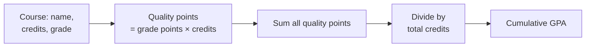

# GPA Calculator

A simple, clean web app that calculates your **cumulative Grade Point Average (GPA)** from your courses, grades, and credit hours. Built with Python and Streamlit.


---

## Features

- **Credit-weighted GPA.** Each course counts in proportion to its credit hours, the same method most universities use.
- **Live summary.** Your GPA, total credits, and quality points update as you add or remove courses.
- **Color-coded status.** The GPA turns green, amber, or red based on your standing.
- **Input validation.** Empty course names and invalid credit values are rejected with a clear message.
- **Simple to customize.** The grading scale is one dictionary in `app.py`.

## Demo

> Add a screenshot or GIF of the running app here. Save it in an `assets/` folder and link it like this:
>
> `


`

## How It Works

GPA is calculated in three steps:



**Example**

| Course              | Credits | Grade | Grade Points | Quality Points |
|---------------------|:-------:|:-----:|:------------:|:--------------:|
| Calculus I          | 3       | A     | 4.0          | 12.0           |
| World History       | 4       | C     | 2.0          | 8.0            |
| Intro to Chemistry  | 4       | B+    | 3.3          | 13.2           |
| **Total**           | **11**  |       |              | **33.2**       |

**GPA = 33.2 ÷ 11 = 3.02**

## Grading Scale

The app uses the standard US 4.0 scale:

| Letter | Points | Letter | Points | Letter | Points |
|:------:|:------:|:------:|:------:|:------:|:------:|
| A+     | 4.0    | B-     | 2.7    | D+     | 1.3    |
| A      | 4.0    | C+     | 2.3    | D      | 1.0    |
| A-     | 3.7    | C      | 2.0    | D-     | 0.7    |
| B+     | 3.3    | C-     | 1.7    | F      | 0.0    |
| B      | 3.0    | D+     | 1.3    |        |        |

> Your school may use a different scale. To change it, edit `GRADE_POINTS` in `app.py`.

## Installation

### Requirements

- Python 3.9 or newer
- pip

### Steps

```bash
# 1. Clone the repository
git clone https://github.com/danyaalchattha654-sudo/gpa-calculator.git
cd gpa-calculator

# 2. (Optional) Create a virtual environment
python -m venv venv
source venv/bin/activate        # On Windows: venv\Scripts\activate

# 3. Install dependencies
pip install -r requirements.txt

# 4. Run the app
streamlit run app.py
```

The app opens automatically at `http://localhost:8501`.

## Usage

1. Enter a **course name**, its **credit hours**, and its **grade**.
2. Click **Add course**.
3. Review your courses in the table and your GPA in the summary.
4. Remove a single course with **Delete selected**, or start over with **Clear all courses**.

> **Note:** Courses are stored in your browser session. Refreshing the page clears them. No data is saved to a server or database.

## Project Structure

```text
gpa-calculator/
├── app.py                # Application logic and interface
├── requirements.txt      # Python dependencies
├── assets/
│   └── gpa-banner.svg    # README banner
└── README.md
```

## Tech Stack

| Tool       | Purpose                          |
|------------|----------------------------------|
| Python     | Core logic                       |
| Streamlit  | Web interface                    |
| pandas     | Course table display             |

## Deployment

The app can be deployed for free on Streamlit Community Cloud:

1. Sign in at [share.streamlit.io](https://share.streamlit.io) with your GitHub account.
2. Select **Create app** > **Deploy a public app from GitHub**.
3. Choose this repository and set the main file path to `app.py`.
4. Click **Deploy**.

Live demo: *[add your app link here]*

## Roadmap

- [ ] Save courses between sessions (CSV export and import)
- [ ] Support for semester-by-semester GPA
- [ ] Support for weighted grades such as honors courses
- [ ] Grading scale selector (4.0, 4.3, or custom)

## Contributing

Suggestions and pull requests are welcome. For major changes, please open an issue first to discuss what you would like to change.

## License

This project is licensed under the MIT License. See the `LICENSE` file for details.

## Author

**Danyaal Chattha**
GitHub: [@danyaalchattha654-sudo](https://github.com/danyaalchattha654-sudo)# gpa-calculator